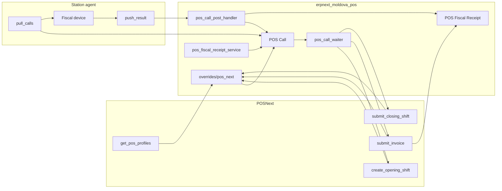
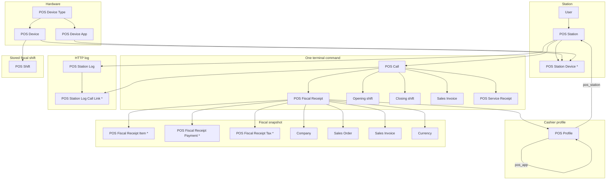

# ERPNext Moldova POS

Frappe app that connects [POSNext](https://github.com/evghenin/POSNext) to a station agent. The agent talks to the fiscal device. ERPNext sends a protocol-neutral command and stores the agent's normalized result. Device-specific encoding (SmartOne, MCR, and others) lives in the agent.

The cashier stays in POSNext. This app turns shift open, sale, and shift close into commands for a station agent. The agent pulls commands from ERPNext and pushes the terminal result back. ERPNext does not open a connection to the device.

The integration is in active development. Follow-ups are listed in [TODO.md](TODO.md).

## Map

```text
erpnext_moldova_pos/
├── hooks.py                         overrides, scheduler, fixtures
├── api/
│   ├── pos_station.py               pull_calls, push_result
│   ├── pos_fiscal_receipt.py        desk actions on POS Fiscal Receipt
│   ├── pos_service_receipt.py       cash deposit and collection during a shift
│   └── pos_tax.py                   tax lookup for a sale
├── overrides/pos_next/              POSNext methods wrapped with a POS Call
│   ├── get_pos_profiles.py
│   ├── create_opening_shift.py      open_shift
│   ├── submit_invoice.py            sale
│   ├── update_invoice.py
│   └── submit_closing_shift.py      close_shift
├── services/
│   ├── pos_call_service.py          create and claim a call
│   ├── pos_call_waiter.py           cashier poll until Completed or Failed
│   ├── pos_call_post_handler.py     write the terminal result back
│   ├── pos_command_payload.py       command body sent to the agent
│   ├── pos_station_auth.py          HMAC and service-user switch
│   ├── pos_station_service.py       station lookup
│   ├── pos_station_device_selector.py
│   ├── pos_call_timeout_watcher.py  scheduler: Pending/Sent → Timeout
│   ├── pos_fiscal_receipt_service.py  POS Fiscal Receipt: snapshot, reconcile
│   ├── pos_fiscal_receipt.py          PDF attached to POS Fiscal Receipt
│   ├── pos_service_receipt_service.py cash deposit, collection, drawer journals
│   ├── receipt_match.py             match list_shifts / receipts / get_receipt
│   ├── order_payments.py
│   └── mev_qr.py
├── fixtures/custom_field.json       POS Profile: pos_app, pos_station
└── moldova_pos/doctype/             documents below
```

Runtime: the cashier stays in POSNext. Overrides create documents. The agent only sees `api/pos_station.py`.



## Requirements

- ERPNext
- POSNext (`pos_next`)
- Python >= 3.10
- Bench

## How a sale reaches the terminal

POSNext methods below are overridden. If the POS Profile has no `pos_station`, the original POSNext method runs unchanged.

| POSNext method | Command | Cashier wait |
| --- | --- | --- |
| `pos_next.api.shifts.create_opening_shift` | `open_shift` | 30s |
| `pos_next.api.invoices.submit_invoice` | `sale` | 300s |
| `pos_next.api.shifts.submit_closing_shift` | `close_shift` | 90s |
| `pos_next.api.pos_profile.get_pos_profiles` | — | Profiles with `pos_app` = `POSNext` only |

Flow:

1. The override creates a **POS Call** (`Pending`) for the station on the POS Profile.
2. The device is chosen from the station's device list. Current commands accept the `All-in-One` app role.
3. The cashier request polls until the call is `Completed` or `Failed`.
4. The station agent calls `pull_calls`, runs the command on the terminal, then calls `push_result`.
5. On success, the original POSNext method runs and the opening or closing shift is linked back to the call. A later close for the same station reuses a `close_shift` call that is still `Pending`, `Sent`, or `Completed` and has no closing shift linked. `Failed` starts a new call.
6. A scheduler job marks calls still `Pending` or `Sent` after 5 minutes as `Timeout`.

`POS Call` statuses: `Pending`, `Sent`, `Completed`, `Failed`, `Timeout`.

`pull_calls` returns a call only after `Pending` becomes `Sent` in this request. A second pull does not receive the same call. `push_result` is accepted from `Sent`. A repeat push for `Completed` or `Failed` returns `{ "duplicate": true }` and does not change the document.

Commands are `open_shift`, `close_shift`, `sale`, `cash_deposit`, `cash_withdrawal`, `list_shifts`, `list_shift_receipts`, and `get_receipt`. `open_shift` asks the station to report device state and carries opening cash. It does not name a device API. Amounts are currency units and quantities are counts. The station adapter encodes them for the device.

Offline invoices are rejected when a station is configured.

## Cash movements

During an open shift the cashier uses `api/pos_service_receipt.py`. A deposit or a collection creates a **POS Service Receipt** (`Unreconciled`) and a **POS Call** (`cash_deposit` or `cash_withdrawal`). The cashier waits 60 seconds. `data` is `{ "amount" }` and, for a withdrawal, `{ "reason": "collection" }`. These commands omit `data.uid`: the terminal ignores it, so a lost answer is not sent again.

`Completed` sets the receipt to `Registered` and stores the device receipt, then posts a Journal Entry. `Failed` deletes the receipt. No answer leaves it `Unreconciled`. The cashier confirms that receipt from `list_shift_receipts` and `get_receipt`. A shift cannot close while one is still unreconciled. Registered movements change the expected cash at close.

`POS Service Receipt.status`: `Unreconciled`, `Registered`, `Rejected`. `movement_type`: `deposit`, `withdrawal`.

When the station app zeros the drawer on a Z-report, open and close also post a Journal Entry: opening cash in, expected cash out. That path needs the cash accounts on the POS Profile.

## POS Profile

Custom fields on **POS Profile**, installed from `fixtures/custom_field.json`:

| Field | Type | Purpose |
| --- | --- | --- |
| `pos_app` | Select `ERPNext` / `POSNext` | Required. POSNext only lists profiles set to `POSNext`. |
| `pos_station` | Link to POS Station | Terminal integration for this profile. Empty means stock POSNext behavior. |

## Documents

Module: **Moldova POS**. Child tables are marked with `*`. ERPNext documents this app only links to are in the right column of the diagram.



| DocType | Depends on | Used by |
| --- | --- | --- |
| POS Device Type | — | POS Device, POS Device App |
| POS Device | POS Device Type | POS Station Device, POS Shift |
| POS Device App | POS Device Type. Role: `All-in-One`, `Fiscal Terminal`, `Payment Terminal`, `Printer` | POS Station Device |
| POS Station | User (`service_user`). Name `POS-ST-#####` | POS Profile, POS Call, POS Fiscal Receipt, POS Station Log |
| POS Station Device * | POS Station, POS Device, POS Device App | Device choice for a command |
| POS Call | POS Station. Optional: POS Fiscal Receipt, POS Service Receipt, opening shift, closing shift, invoice | Agent `pull_calls` / `push_result`, waiter, logs |
| POS Service Receipt | POS Station, POS Profile, Company, opening shift. Optional: POS Call, Journal Entry | Cash deposit and collection |
| POS Fiscal Receipt | POS Station, POS Profile, Company, Currency. Optional: POS Call, Sales Invoice, Sales Order | Sale payload, reconcile, PDF |
| POS Fiscal Receipt Item * | parent receipt | Match on `get_receipt` |
| POS Fiscal Receipt Payment * | parent receipt | Match on `get_receipt` |
| POS Fiscal Receipt Tax * | parent receipt | Tax snapshot |
| POS Station Log | POS Station | Desk diagnostics |
| POS Station Log Call Link * | POS Station Log, POS Call | Which calls were in one HTTP exchange |
| POS Shift | POS Device. Optional opening and closing references | Not used by the open/close flow yet |

`POS Call.command`: `open_shift`, `close_shift`, `sale`, `cash_deposit`, `cash_withdrawal`, `list_shifts`, `list_shift_receipts`, `get_receipt`.

`POS Call.status`: `Pending` → `Sent` → `Completed` or `Failed`. `Timeout` is set by the scheduler. A sale with no station result returns to `Pending`.

`POS Fiscal Receipt.status`: `Open`, `Registered`, `Invoiced`, `Unreconciled`, `Not Found`, `Rejected`.

Who writes which link:

| Event | Documents |
| --- | --- |
| Profile has `pos_station` | Override creates **POS Call** (`Pending`) on that station |
| `sale` | **POS Fiscal Receipt** is created first. `POS Call.pos_fiscal_receipt` and `POS Fiscal Receipt.pos_call` point at each other. `data.uid` is the receipt GUID |
| `push_result` success | Call becomes `Completed`. Post-handler fills the receipt from `receipt`. Then the original POSNext method runs |
| After POSNext returns | Opening shift, closing shift, or invoice is written back onto the call. Invoice is also written onto the receipt |
| Reconcile | New calls `list_shifts`, `list_shift_receipts`, `get_receipt` on the same station, all linked to the same receipt |
| Cash deposit or collection | **POS Service Receipt** plus a `cash_deposit` or `cash_withdrawal` call. A Journal Entry is written when the receipt becomes `Registered` |
| Every station HTTP call | **POS Station Log** plus one **POS Station Log Call Link** per call in the body |

Permissions on these DocTypes are System Manager only.

## Station API

Guest whitelisted methods. The station signs every request with HMAC-SHA256.

Headers:

| Header | Required on |
| --- | --- |
| `X-POS-Timestamp` | both |
| `X-POS-Nonce` | both |
| `X-POS-Signature` | both |
| `X-POS-Station` | `push_result` |

Signature:

```text
base64(HMAC_SHA256(shared_secret, "{pos_station}:{timestamp}:{nonce}"))
```

The timestamp must be within 60 seconds of the server time. A valid signature switches the request to the station's service user.

| Method | Path |
| --- | --- |
| `pull_calls` | `/api/method/erpnext_moldova_pos.api.pos_station.pull_calls` |
| `push_result` | `/api/method/erpnext_moldova_pos.api.pos_station.push_result` |

`pull_calls` takes `pos_station` and returns up to 10 pending calls (`pos_call`, `command`, `payload`). Each returned call was claimed (`Pending` → `Sent`) by this request.

`push_result` takes `pos_call`, `success`, and `payload`. It completes a `Sent` call and runs the command post-handler. `payload` is stored on `POS Call.result`.

Payload sent to the station:

```json
{
  "device": {
    "serial_number": "..."
  },
  "user": "Cashier Name",
  "data": {
    "uid": "POS-CALL-NAME"
  }
}
```

`data.uid` is the POS Call name, except on `sale`, where it is the GUID stored on POS Fiscal Receipt (`uid`). The fiscal service keeps that value only when it is a GUID. `cash_deposit` and `cash_withdrawal` omit `uid`. Sale `data` also has `number`, `currency`, `amount`, `items`, and `payments`. Item fields are `code`, `name`, `qty`, `unit`, `price`, `discount`, `amount`, and `tax_rates` (ERPNext percents as stored, such as `20` for 20%). Payment fields are `type` (`Cash`, `Bank`, `General`, or whatever POSNext sent), `mode_of_payment`, and `amount`. Open-shift `data` has `uid` and `opening_balances`: `type`, `mode_of_payment`, and `amount`. Close-shift `data` is `{ "uid": "..." }`. `cash_deposit` data is `{ "amount" }`. `cash_withdrawal` data is `{ "amount", "reason": "collection" }`. `list_shifts` data is `{}`. `list_shift_receipts` data is `{ "shift_id": "..." }`. `get_receipt` data is `{ "receipt_id": "..." }`.

The station replies with a normalized payload. Device field names stay in the station adapter.

```json
{
  "ok": true,
  "shift": { "shift_id": "10", "fiscal_id": "" },
  "receipt": {
    "uid": "POS-CALL-NAME",
    "id": "",
    "number": "",
    "mev_id": "",
    "amount": 0,
    "type": 0,
    "date": "",
    "verification_url": "https://..."
  },
  "receipts": [
    { "id": "", "number": "", "mev_id": "", "amount": 0, "type": 0, "date": "", "verification_url": "https://..." }
  ],
  "error": {
    "message": "",
    "code": "",
    "item_code": "",
    "tax_rate": 20,
    "device_vat": [{ "code": "A", "rate": 20 }]
  },
  "raw": {}
}
```

ERPNext reads `shift`, `shifts`, `receipt`, `receipts`, and `error`. `verification_url` is the only receipt-check link, and only an `http://` or `https://` value is stored. `error` is set when the command fails. `raw` is stored for diagnostics and is not interpreted.

An unreconciled POS Fiscal Receipt is resolved in ERPNext, not in the station:

1. `list_shifts` with empty `data`. The station returns every shift it can read. ERPNext keeps the one shift whose `opened_at` / `closed_at` contains `sale_at`. An empty `closed_at` means the shift is still open and ends at the current time.
2. `list_shift_receipts` with `data.shift_id`. ERPNext picks one row with a numeric `amount`, sale `type` `0`, then `number`, `mev_id`, `id`, and the closest `date`. A null amount or a null type does not match.
3. `get_receipt` with `data.receipt_id`. ERPNext accepts it only when `amount`, `items` (`code`, `qty`, `price`, `amount`), and `payments` (`type`, `amount`) match the POS Fiscal Receipt.

`list_shifts` success payload:

```json
{
  "ok": true,
  "shifts": [
    { "shift_id": "10", "fiscal_id": "", "opened_at": "", "closed_at": "" }
  ],
  "raw": {}
}
```

`list_shift_receipts` data is `{ "shift_id": "10" }`. The success payload uses `receipts` as in the sale reply. `closed_at` is an empty string while the shift is open.

`get_receipt` data:

```json
{ "receipt_id": "device-receipt-id" }
```

`get_receipt` success payload:

```json
{
  "ok": true,
  "receipt": {
    "id": "device-receipt-id",
    "number": "",
    "mev_id": "",
    "amount": 0,
    "type": 0,
    "date": "",
    "verification_url": "https://...",
    "items": [
      { "code": "", "name": "", "qty": 1, "unit": "", "price": 0, "amount": 0 }
    ],
    "payments": [
      { "type": "Cash", "amount": 0 }
    ]
  },
  "raw": {}
}
```

Amounts are currency units and quantities are counts, the same units as a `sale` command. `items` and `payments` are the device lines after the adapter maps them. An unknown `receipt_id` is a failed result with `error.message`, not an empty receipt.

## Scheduler

Every 2 minutes:

`erpnext_moldova_pos.services.pos_call_timeout_watcher.mark_timed_out_pos_calls`

Calls in `Pending` or `Sent` older than 5 minutes become `Timeout`, except `sale`. A sale with no station result returns to `Pending` and is pulled again with the same `data.uid`. Silence is not a rejection.

## Installation

```bash
cd $PATH_TO_YOUR_BENCH
bench get-app $URL_OF_THIS_REPO --branch develop
bench install-app erpnext_moldova_pos
```

Install ERPNext and POSNext on the same bench first. After install, `bench migrate` loads the POS Profile custom fields from fixtures.

## Development

Local site used for this app: `development.localhost`.

```bash
cd apps/erpnext_moldova_pos
pre-commit install
```

Pre-commit runs ruff, eslint, prettier, and pyupgrade.

Python line length is 110, indent is tabs (`pyproject.toml`).

## License

MIT
